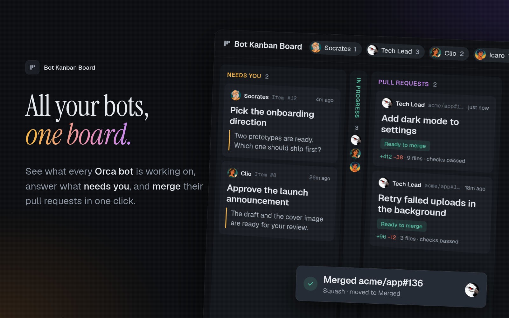

# Bot Kanban Board

See your Orca bots’ Items alongside the GitHub pull requests they are working on, across this computer and its paired computers.

## Install and first run

Install **Bot Kanban Board** from the Orca desktop plugin page (macOS or Linux, Orca 1.4.274 or later). For a local checkout, run `orca plugin install . --json` and follow its approval instructions. Install the Orca and GitHub CLIs, sign in to GitHub with `gh auth login`, and make sure the Orca desktop session can see your bots.

Choose **Open Bot Kanban Board** from the command palette or click **Needs you** in the status bar. The plugin creates and opens a **Board.botkanban** editor in a hidden utility project. To explore without live data, enable **Demo data** in Orca’s plugin settings and restart the plugin. On a demo-only first run, follow the setup message to add the board folder.

## Read the columns

- **Waiting** holds waiting and planned Items. **Needs you** shows questions, oldest first. **In progress** shows active work.
- **Closed** contains Items completed or canceled today. Click a lane heading to expand or fold it.
- **Pull requests** groups ready, draft and unassigned PRs. Open a card for its files, diff and merge details. Stacks show the base PR before its dependents.
- **Merged** shows today’s merges in local time, newest first. Use the PR link to open GitHub.

## Work on the board

Click a bot chip to hide or show its cards. Right-click, Option-click or Command-click to show that bot alone, including its mapped merges and Closed Items. Repeat the gesture to show everyone. A bot with only history today can have a chip with a count of zero. Use **Filters** for repository filters, **Needs me only**, saved views, snoozed Items and computer status.

Open a PR and choose **Merge**, or drag it onto the merge zone. To close it without merging, drag it onto **Close PR** and confirm. For a batch, use a PR’s checkbox or drag a rectangle from empty board space. Shift or Command adds to your selection. Escape clears it. Choose **Merge all** or drag the selected PRs together to start the queue.

Use an open card’s bell to receive one notification when an Item changes status or a PR is ready to merge. Item bells need the worker running. PR bells are checked while the board is visible and when you return to it. Use an Item’s **More** menu for snooze, chat and status requests. Status changes are prepared as messages for you to paste into the bot’s chat. An unconfirmed request expires after ten minutes.

## Settings

Open the gear to change the board’s saved preferences.

- **Display** turns compact cards on or off. Compact Items and PRs show a photo, one-line title, age and a tag for drafts. Hover for the full title and bot.
- **Merging** preselects Squash, Merge or Rebase. Turn off **Ask before merging** for one-step merges of clean PRs. Warnings and conflicts still open the dialog.
- **After a merge** sends one Orca message to the selected bot after a merge or a batch. Turn on **Tell a bot** to choose a recipient.

Orca’s plugin settings also control executable paths, refresh intervals and demo mode. Item reads default to 30 seconds and PR reads to 90 seconds. Click the read timestamp for a manual refresh.

## Troubleshooting

- **GitHub unavailable.** The board keeps the previous data and reports the retry time. On first load, use **Try again** to read immediately. For an authentication error, sign in with `gh auth login` in your desktop account. For a missing executable, set the GitHub CLI path in Orca’s plugin settings.
- **Rate limit reached.** Wait for the time shown. The worker uses GitHub’s reset or retry header when available and otherwise waits six minutes.
- **A remote bot is missing.** Check the computer status in Filters and reconnect the paired computer. A remote photo read briefly opens a terminal in the bot’s workspace. Initials appear until a verified photo is available.
- **A bot session cannot read live data.** Open the board from your own desktop session.
- **A PR or patch is missing.** Open-PR search stops after five pages of 40, and merged search reads the first 40 results. The files API returns up to 3,000 files. Large or binary files may have no patch. Follow the GitHub link in the drawer for the full change.

## How it works

```text
The worker discovers local and paired Orca bots. It reads orca bot item list
and orca bot work list per bot, and orca worktree ps per computer.
GitHub GraphQL searches read open PRs and today's merges in the login's repositories.

A PR matches an Item that mentions its PR URL or repo#number. Otherwise the
board matches issues referenced by that PR to Items. A matching head branch
and repository also associate a PR with the bot that owns the workspace.

The queue processes PRs sequentially, rechecks each PR, asks about warnings,
marks drafts ready and merges the confirmed head SHA with the chosen method.
Failed entries retry twice and can then be retried manually. The optional
post-merge message uses terminal.create (orca terminal create) in the chosen
bot's workspace to run orca orchestration send. A batch sends one summary.

Items refresh every 30 seconds by default and after agent status changes.
Visible panels poll GitHub every 90 seconds by default and refresh on return.
Failed reads back off to 90 seconds, 3 minutes, then 6 minutes. Rate limits
wait for the reported reset or retry time, or 6 minutes without headers.
The worker caches the login for the session and repository facts for 6 hours.

Plugin storage holds views and filters, folded lanes, bells, pending status
requests, local snoozes, avatar data and merge/display preferences. It also saves the last successful Orca and GitHub snapshots separately. The board
opens with those cards dimmed until each source refreshes.
```

## Develop

Install the pinned pnpm version and run `pnpm install --frozen-lockfile`. Generate host declarations with `orca plugin types . --json`, or use `bash scripts/host-types.sh` on headless machines without the bundled declarations. Run `pnpm check` for formatting, strict type checks, lint and core unit tests. The plugin loads its TypeScript directly. The synthetic demo entry is `editor/demo.html` and can be served by a TypeScript-aware development server.

Serve the demo with `pnpm exec vite` if Vite is installed, then open `/editor/demo.html`. Append `?state=failure` to simulate one failed merge and try Retry.

## Credits

Created by [Guilherme Latrova](https://github.com/guilatrova). The board uses Geist fonts under the [SIL Open Font License](editor/fonts/OFL.txt).
