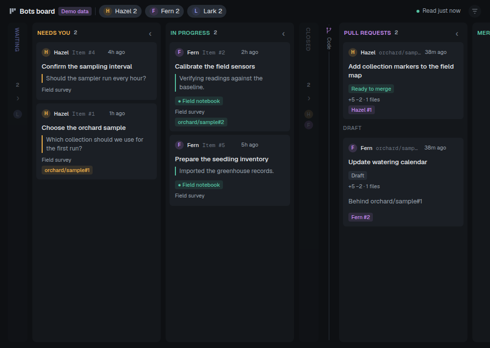

# Orca Bots Board

Open **Open bots board** from the Orca command palette to see open Items on this computer and its saved paired computers. Select **Needs you** in the status bar to jump to the oldest outstanding questions. Click a bot to filter, or Alt-click or Cmd-click to show that bot alone.

Item drawers show the question, suggested replies, worker reports and links to related pull requests. **Answer in Orca** opens the bot workspace so you can reply in its chat. Pull request drawers show changed files, expandable diffs and links to GitHub. The board matches pull requests by workspace branch, direct Item reference or closing issue.

Drag a pull request onto **Merge** in the Merged column or select **Merge** in its drawer to review its warnings and allowed methods. Confirming a draft marks it ready before attempting the merge. The Merged column shows today’s merges in local time, newest first. Click a merged card to open it on GitHub. Drop an open pull request onto **Close PR** to close it after confirmation.

## Organize the board

Use the bot chips, **Repositories**, and **Needs me only** to filter the board. **Needs me only** includes Items in Needs you and open, non-draft pull requests. Items without a known repository stay visible under repository filters. The board uses a matched PR or a workspace linked to an Item’s worker when it can identify the repository. Merged PRs have no bot assignment and are hidden under bot filters.

Open the filter menu to see saved views, filters, snoozed Items and computer status. Select **View** to save the current filters, switch views, rename a saved view or delete it. The board restores your last selection when you reopen it.

Click any column header to fold or expand it. Waiting includes Planned Items. Closed shows Items completed or cancelled today. Drag an Item to a status column, or choose **Completed** or **Cancelled** in the Closed column. Right-click or select **More** for status requests, snooze and chat. You can also request a status from the Item drawer. Cancel requires a reason. Copy the prepared message, select **Open bot chat in Orca**, and paste the request in the bot’s chat. The card stays in its current column until Orca reports the change. An unconfirmed request expires after ten minutes.

Snoozing hides an Item locally for one hour, until tomorrow at 9 a.m., or until Monday at 9 a.m. (local time). Open **Snoozed** to wake it early. Orca’s own snoozes are labeled separately and expire at the time Orca sets. Stacked PRs name their open base PR on the card and in the drawer. The merge dialog warns when that base is still open.

Select an open card’s bell to receive one notification when its Item changes status or its pull request is ready to merge. Orca’s plugin worker must be running.

[Saved views](docs/screenshots/phase-3/views.png) · [Drop zones](docs/screenshots/issue-9/item-drag.png) · [Item actions](docs/screenshots/issue-9/submenu.png) · [Drawer status selector](docs/screenshots/phase-3/drawer.png) · [Requested move](docs/screenshots/phase-3/requested.png) · [Chat handoff](docs/screenshots/phase-3/handoff.png) · [Cancellation reason](docs/screenshots/phase-3/cancel.png) · [Snoozed Items](docs/screenshots/phase-3/snoozed.png) · [Stack warning](docs/screenshots/phase-3/stack.png)

## Install

Use Orca desktop 1.4.274 or later on macOS or Linux. Install the Orca CLI and GitHub CLI, then sign in with `gh auth login`. From a local checkout, run `orca plugin install . --json` (or `orca plugin dev load . --json` for development). Review the requested permissions and follow the approval command Orca prints. Open the board from your own desktop session.

## Access

The trusted worker runs Node.js with your account’s access. Live mode invokes the Orca and GitHub CLIs, reads available bot avatars on their owning computers and maintains a board file in the application data directory.

- `storage:own` persists filters, named views, requested moves, local snoozes, folded columns and bells.
- `notifications:show` delivers one-shot bell notifications through Orca.
- `settings:own` reads executable paths, polling intervals and the demo setting.
- `workspace:read` locates board and bot workspaces.
- `workspace:write` opens the board editor and bot workspaces and hides the board’s utility project.
- `agent:read` subscribes to agent status changes to refresh Items.

## Settings

| Setting                       | Default                                |
| ----------------------------- | -------------------------------------- |
| Orca executable path          | Search PATH and platform CLI locations |
| GitHub CLI executable path    | Search PATH and platform CLI locations |
| Item refresh interval         | 30 seconds                             |
| Pull request refresh interval | 90 seconds                             |

**Demo data** defaults to off. Change it in the plugin settings, restart the plugin, and reopen the board. The demo worker uses synthetic records, runs no CLI commands and keeps its views and actions separate. Both modes open the same hidden board project in the application data directory. On a demo-only first run, add the folder shown by the setup message as an Orca folder project, then reopen the board.

**Refresh** reads both sources immediately. A GitHub failure keeps the last successful pull request list with its age.

## Known limits

- Orca limits Item status writes to the bot’s own chat. The board prepares a message for the owner to send. Snooze affects this board only. Answer questions in Orca. [Upstream owner API request](https://github.com/stablyai/orca/issues/48010).

- Merged history reads the first 40 GitHub search results sorted by update time. Merge queues require continuing on GitHub. After merging, tell the owning bot in Orca.

- GitHub search reads up to five pages of 40 open pull requests. The board shows the open total. The PR files API returns up to 3,000 files. When fewer files arrive than the reported number of changes, the drawer shows both counts and a GitHub files link. Binary and large files can have no patch.
- A remote photo read briefly opens a terminal tab in the bot’s workspace on its paired computer. The worker checks the digest on the first photo request after startup and at most once every six hours afterward. A failed check keeps the last verified photo. Initials appear if no verified photo is available. Local photos are read directly from disk.
- Orca opens a bot's workspace. Select the original chat there to answer. The bot deep link is a fallback when the folder workspace cannot be opened.
- Desktop operation and paired-computer jumps still need an end-to-end run on a Mac. The CLI runner detects inherited bot-session context and directs the operator to open the board from the desktop as themselves.

## Development

Install the pinned pnpm version and run `pnpm install --frozen-lockfile`. Generate host declarations with `orca plugin types . --json`, or use `bash scripts/host-types.sh` on headless machines without the bundled declarations. Run `pnpm check` for formatting, strict type checks, lint and core unit tests. The plugin loads its TypeScript directly. The synthetic demo entry is `editor/demo.html` and can be served by a TypeScript-aware development server.
